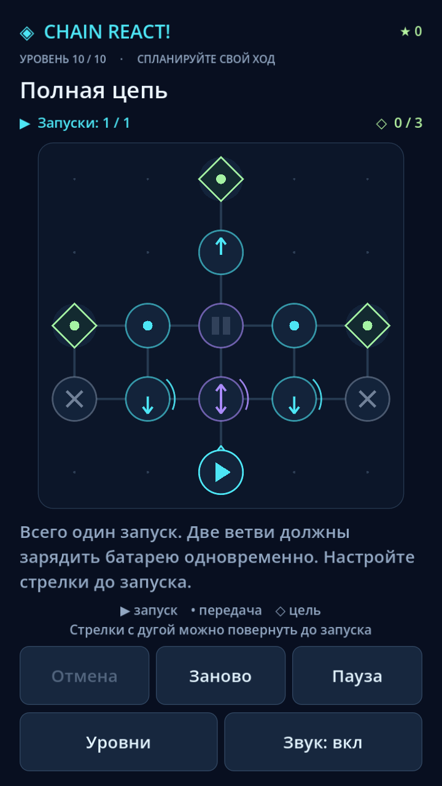

# Chain React! — One Tap Puzzle

Рабочий MVP 2D-головоломки на Godot 4 / GDScript для Android. Портретное поле 5×5, десять авторских уровней, процедурная графика и синтезированные звуки без платных ассетов и внешних библиотек.



Техническая и визуальная приёмка: 138 проверок, 21 реальный скриншот в трёх разрешениях. [Галерея](docs/screenshots/README.md) · [Отчёт](docs/verification.md).

## Запуск

Проверено с **Godot 4.7.2 Standard**, без .NET. Откройте `project.godot` в редакторе и нажмите **F6** для открытой сцены `scenes/main.tscn` или **F5** для всего проекта.

```bash
godot --path .
```

В этой среде бинарник установлен временно: `/tmp/chain-godot/Godot_v4.7.2-stable_linux.x86_64`. Он не входит в Git. На другом компьютере установите Godot самостоятельно.

## Как играть

- Нажмите на источник с треугольником, чтобы запустить волну энергии.
- Нажмите на стрелку или развилку с дугой, чтобы повернуть её на 90° по часовой стрелке. Повороты разрешены до первого запуска и не расходуют запуски.
- Зажгите все ромбы-цели до исчерпания запусков.
- Батарея требует двух попаданий; заряд и активированные цели сохраняются между запусками.
- «Отмена» восстанавливает поворот или весь последний запуск. «Заново» сбрасывает уровень. «Пауза» останавливает реакцию; Escape/Android Back открывает и закрывает её.
- Все 10 уровней доступны через «Уровни». Звук можно отключить. После победы доступен следующий уровень.
- 3 звезды выдаются за решение в пределах `par_launches`: 2 запуска для уровней 6 и 8, 1 для остальных. Иначе — 2 звезды. Лучшие результаты сохраняются. Финальный уровень требует одного запуска и настройки обеих ветвей.
- При старте открывается главное меню. Из паузы можно вернуться в меню; возврат из выбора уровней сохраняет исходный экран результата или меню.

## Правила симуляции

Ортогональные соседи, направления `0=вверх, 1=вправо, 2=вниз, 3=влево`. Источник и развилка излучают по `dirs`; directional — по одной стрелке; normal и заряженная battery — в четыре стороны. Цель, блок и пустота останавливают импульсы. Источник не ретранслирует входящие попадания.

Все попадания одной волны сначала группируются, затем узлы активируются в порядке индексов. Каждый узел излучает не более одного раза за запуск; это ограничивает циклы. Батарея может принять два одновременных попадания. Внешние часы и анимации на результат не влияют.

## Структура

| Файлы | Назначение |
|---|---|
| `project.godot`, `scenes/main.tscn` | Настройки и стартовая сцена |
| `scripts/core/reaction_engine.gd` | Чистый движок, волны, снимки состояния |
| `scripts/core/grid_manager.gd` | Состояние поля, история, ограничения действий |
| `scripts/core/game_manager.gd` | Координация, пауза, сигналы, отмена устаревших анимаций |
| `scripts/core/level_loader.gd` | Загрузка JSON и проверка схемы |
| `scripts/core/level_validator.gd` | Проверка данных, ограниченный поиск решений |
| `scripts/core/save_manager.gd` | Формат v1, атомарная запись, обработка повреждений |
| `scripts/core/progression_manager.gd` | Последний уровень, лучшие звёзды, звук |
| `scripts/ui/ui_manager.gd`, `board.gd` | HUD, диалоги, ввод, графика и эффекты |
| `levels/01.json` … `10.json` | Авторские уровни и обучающие подсказки |
| `tests/` | Модель, уровни, сохранения, UI, настоящий touch dispatch |
| `tools/` | Общий прогон, CPU-замер и скриншот через виртуальный дисплей |
| `export_presets.cfg` | Заготовка экспорта Android APK arm64 |

## Проверки

```bash
GODOT_BIN=godot tools/check.sh
# Только проверка решений:
godot --headless --path . --script tests/test_levels.gd
# CPU-замер:
godot --headless --path . --script tools/benchmark.gd
```

Скрипт сначала импортирует проект, затем запускает шесть наборов тестов и стартовую сцену. Каждый набор возвращает ненулевой код при провале; timeout ограничивает зависания. UI-тесты используют отдельные файлы сохранений. Валидатор перебирает допустимые ориентации и последовательности источников, затем тест повторно проигрывает решение через GridManager. Лимит поиска — 200000 состояний; достижение лимита не доказывает непроходимость произвольного нового уровня.

Фактические результаты и ограничения: [docs/verification.md](docs/verification.md). Инструкции и источники Skills: [docs/skills.md](docs/skills.md).

## Android

APK/AAB в этой среде **не собраны**: нет настроенных Android SDK, export templates и ключа подписи. При импорте редактор сообщает об отсутствующей директории Android build-tools; это не мешает запуску и headless-тестам.

Для APK установите export templates **точно версии редактора**, OpenJDK 17 и Android SDK; укажите пути в Editor Settings → Export → Android. Откройте preset Android и настройте debug signing. Создайте `build/android/`, затем:

```bash
godot --headless --path . --export-debug Android build/android/chain-react.apk
```

Для Google Play нужны Gradle/AAB и release keystore; проверьте package ID перед публикацией. Ключи и пароли не должны попадать в репозиторий. Точные требования SDK и порядок подписания: [официальная документация Godot](https://docs.godotengine.org/en/stable/tutorials/export/exporting_for_android.html).

Перед релизом необходимы тесты на реальных Android-устройствах: touch, системный Back, вырезы и safe area, сворачивание/возврат, звук, сохранение после перезапуска, FPS/нагрев. Также нужны финальные launcher icons, пользовательские плейтесты сложности и материалы магазина.

Реальные AdMob, покупки, серверы и аккаунты отсутствуют по ТЗ. Навык монетизации подключён для последующих этапов; MVP не зависит от рекламных SDK.

Для графической приёмки на Linux используйте Xvfb:

```bash
xvfb-run -a -s "-screen 0 1600x3400x24" godot --path . --resolution 720x1280 --audio-driver Dummy --script tools/acceptance_capture.gd
```

Повторите с `1080x1920` и `1440x3200`. Скрипт проходит все уровни через сцену, достигает победы/поражения, проверяет границы видимых кнопок/текста и сохраняет PNG точного размера. Это программное прохождение; тестирование пальцем и субъективная оценка сложности на телефоне ещё нужны.
