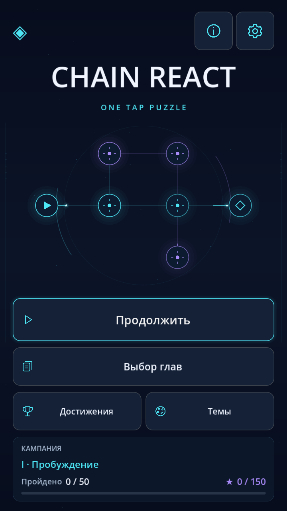

# Chain React! — One Tap Puzzle · 0.5.0

Мобильная 2D-головоломка Godot 4 / GDScript: **5 глав, 50 авторских уровней**, portrait, процедурные узлы, SFX, локальные сохранения. Без рекламы, покупок, аналитики и системы подсказок.



**[Скачать debug APK0.5.0 ARM64 и отчёты (ZIP)](https://github.com/Unbearable22/Mobilegame/actions/runs/43204226679/artifacts/13937640075)** — вход в GitHub,14дней. APK **28 438 529байт**, SHA256 `d5c95cbfbb8132be5f986d0d676ffc62bcf5a02430deddac6c11e704d3216c7f`. [Проверенный CI-отчёт](docs/android-v5-ci-artifact.json).

## Запуск

Godot **4.7.2 Standard**, без .NET. Открыть `project.godot`, нажать F5, либо:

```bash
godot --path .
```

В рабочем окружении бинарник: `/tmp/chain-godot/Godot_v4.7.2-stable_linux.x86_64` (не часть Git).

## Управление

- Источник с треугольником запускает энергию. Дуга у стрелки означает, что её можно повернуть на 90° до первого запуска.
- Зажгите все ромбы. Батарея требует два попадания, заряд и цели сохраняются между запусками. Все выходы видны заранее.
- Внизу: Undo, Restart, Pause, Chapters. Вверху: Information и Settings. В справочнике показаны настоящие игровые узлы, общие правила и примеры — решения текущего уровня он не выдаёт.
- Счётчик ▶ показывает оставшиеся запуски; ◇ — достигнутые цели. После фиксации схемы появляется маленький замок вместо дуги вращения.
- За победу в пределах нормы запусков — три звезды, иначе две. В списке уровней только номера и маленькие звёзды; повороты попытки не расходуют. Лучший результат сохраняется.
- Главы открываются последовательно после десяти побед в предыдущей, без требования собрать все звёзды. В открытой главе доступны все её уровни. Старый прогресс 0.2.0 сохраняется.
- Android Back возвращает на предыдущий экран; Information/Settings/Pause останавливают цепь. SFX отключаются через шестерёнку.

## Кампания

| Глава | Уровни | Цель |
|---|---|---|
| I · Пробуждение | 1–10 | Прежние схемы: освоение семи типов узлов |
| II · Переплетение | 11–20 | Длинные маршруты, развилки, общие выходы |
| III · Перегрузка | 21–30 | Батареи, источники и задачи на порядок запусков |
| IV · Парадокс | 31–40 | Ложные прямые пути, поглощение, неравные ветви |
| V · Сингулярность | 41–50 | Все семь типов; финал с шестью обязательными настройками |

Схемы не генерируются случайно. [Цели и оценки всех уровней](docs/campaign-design.md), [II/III](docs/level-design-ii-iii.md), [IV/V](docs/level-design-iv-v.md). Автоматические доказательства не заменяют пользовательский плейтест.

## Новое в0.5.0

10сохраняемых достижений;5разблокируемых тем; настройка уменьшения эффектов; зарядные вспышки/следы импульсов/одновременные волны/анимация звёзд и уведомления; локальные агрегаты попыток/времени/запусков с JSON-экспортом через настройки. Без персональных данных и сети. [Правила, определения статистики и экспорт](docs/retention-v5.md).

Выбор уровней содержит только заголовок главы,10номерных кнопок с маленькими звёздами, неоновую рамку текущего уровня и возврат к главам. Нормы/описания/tooltip с лимитами удалены, сами игровые ограничения и прогрессия сохранены.

## Уровни19 и49

Оба уровня проверены через асинхронный GameManager, полный перебор и удаление отдельных узлов. Затем пользователь подтвердил их на физическом телефоне в0.4.0. JSON и правила сохранены; [трассы диагностики](docs/v4-level-diagnostics.md) остаются в истории.

## Проверки

```bash
GODOT_BIN=godot tools/check.sh
python3 tests/test_android_tools.py
python3 tests/test_level_design.py
godot --headless --path . --script tools/benchmark.gd
```

1026 проверок GDScript и 8 Python-тестов; отдельно все 50 уровней полностью проверены `LevelAuditor`: 48 242 симуляции через игровой движок. Проверены решения, три звезды, нижние границы числа настроенных узлов, заявленный порядок источников и отсутствие топологических клонов. `build/level-audit.json` содержит результаты каждого уровня и включается в CI artifact. Лимит перебора приводит к провалу проверки, а не к ложному успеху.

[Отчёт](docs/verification.md) · [Галерея трёх разрешений](docs/screenshots/README.md).

## Архитектура

`ReactionEngine` — чистая волновая симуляция, `GridManager` — состояние/история, `GameManager` — действия/сигналы/анимационная координация. `ChapterCatalog` задаёт главы и размер кампании, `ProgressionManager` — доступность и звёзды, `LevelLoader/Validator` — схема, `LevelAuditor` — офлайн-проверка дизайна. `SaveManager` читает v1/v2/v3 и атомарно пишет v3; перед миграцией сохраняет `.v1.bak`/`.v2.bak`. `SettingsManager` остаётся единственным API предпочтений поверх сохранённого `sound`.

`UIManager`, `MainMenu`, `MenuReaction`, `IconLibrary` и `NodeGuide` строят интерфейс. Полноэкранное меню показывает текущую главу, уровни из50, звёзды из150 и завершение кампании. «Продолжить» возвращает последний выбранный доступный уровень; незавершённая реакция продолжается без перезапуска. Декоративная цепь изолирована от GameManager/сохранений и останавливается за другими экранами и в фоне. Уменьшение эффектов останавливает косметическую анимацию, сохраняет статическую обратную связь и применяется к звёздам/уведомлениям. Справочник повторно использует `Board`, а не отдельные условные картинки. Иконки собственные, растеризуются один раз и кешируются. Поле перерисовывается по событиям; solver/auditor не запускаются на телефоне. Неповоротные/заряженные/достигнутые состояния различимы символами и заполнением, а не только цветом.

## Android

APK ARM64 собирается существующим [GitHub Actions](https://github.com/Unbearable22/Mobilegame/actions/workflows/android-debug.yml) и проверяется перед загрузкой артефакта. [Сборка и скачивание](docs/android-build.md), [чек-лист телефона](docs/android-device-checklist.md). Package ID **`org.chainreact.onetappuzzle` не изменён**, minSdk24, targetSdk36, Compatibility/OpenGL, portrait. Ключи не входят в Git.

Пользователь подтвердил работу 0.2.0 на реальном смартфоне. Пользователь также подтвердил0.4.0, включая19/49, сохранения и навигацию. **Изменения0.5.0 физически ещё не проверены**. При смене CI debug-подписи перед удалением старой установки [сохраните и восстановите прогресс через adb run-as](docs/android-progress-transfer.md); это ограничение Android signing, не миграции JSON.

Графическая проверка Linux:

```bash
xvfb-run -a -s '-screen 0 1600x3400x24' godot --path . --resolution 720x1280 --audio-driver Dummy --script tools/v5_capture.gd
```

Повторить с 1080×1920 и 1440×3200. [История исправления Android touch](docs/android-touch-debug.md), [настройки](docs/settings-system.md), [установленные навыки](docs/skills.md).
